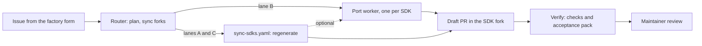

# SDK factory

The SDK factory carries one change across the OpenFGA SDKs. You describe the
change in an issue. The factory posts a plan, opens a draft pull request in
each SDK, and checks each one. A maintainer reviews and merges every pull
request. The factory never merges, approves, or pushes to a default branch.

This copy is a lab. It changes forks that belong to the owner of this
repository (the hub), never the upstream repositories.



## Lanes

| Lane | Source | What runs | Model calls |
|---|---|---|---|
| A: API spec bump | A commit, pull request or `tree/<ref>` of the API repository | `sync-sdks.yaml` regenerates each SDK against that spec and opens a sync PR | None, unless you ask for port workers on the sync PRs |
| B: port an SDK change | A pull request, commit or issue in one SDK | One port worker per target SDK. Each opens a draft PR in its fork | One worker run per SDK |
| C: generator template change | A pull request, commit or `tree/<branch>` of the generator, here or upstream | `sync-sdks.yaml` regenerates each SDK from that generator ref and opens a sync PR | Same as lane A |

The port worker is the only step that calls a model. The router, the
scanners, the sync job, the verify job and the trace job are plain scripts.

Lanes A and C apply only what the change alters. The sync job builds each SDK
twice, both times on top of the SDK's main: once before the change and once
after. Git then merges the difference into main. Release versions, hand edits
and every line the change leaves alone stay as main has them. "Before" is
`OPEN_API_REF` in the Makefile for lane A, and for lane C the generator commit
before the change: the parent of a commit on main, or the point where a branch
left main. If the change touches a line that main edited by hand, the job
stops and names the files to merge by hand. `factory/scripts/delta_sync.sh`
does this. Some build steps run in Docker as root and leave files the runner
cannot write, so before the second build the script writes those files again
from main. A sync run without a change id still regenerates the whole SDK.

## Workflows

| Workflow | File | Trigger | What it does |
|---|---|---|---|
| SDK factory router | `factory-propagate.yml` | The `factory:propagate` label, or a manual run with an issue number | Checks that the sender can write here, posts the plan, syncs the target forks and starts the lane |
| SDK factory port worker | `factory-port.md`, compiled to `factory-port.lock.yml` | Started by the router or by the sync job | Ports one change into one fork and opens one draft PR |
| Sync SDKs with generator | `sync-sdks.yaml` | A manual run, or a push to main | Regenerates the SDKs. The factory adds a change id, delta mode, a record of the sync PRs and an optional port step |
| SDK factory verify | `factory-verify.yml` | After a worker or sync run, every 6 hours, or a manual run | Runs the checks and the acceptance pack on each open factory PR, labels it and reports |
| SDK factory trace | `factory-trace.yml` | After each port worker run, or a manual run with a run id | Reads the run's session log with agent-strace and comments the agent's evidence on each PR the run opened |
| SDK factory watcher | `factory-watch.yml` | Daily, or a manual run (a dry run by default) | Opens a `factory:candidate` issue for each feat or fix PR merged upstream that no factory issue covers |
| SDK factory API drift | `factory-api-drift.yml` | Weekly, or a manual run | Keeps one `factory:api-drift` issue open while the API is ahead of `OPEN_API_REF` in the Makefile |
| SDK factory fork sync | `factory-sync-forks.yml` | Daily, or a manual run | Brings the hub, the API fork and each SDK fork up to upstream main. Without `FACTORY_TOKEN` it only reports |
| SDK factory CI | `factory-ci.yml` | Pull requests and pushes that touch the factory | Unit tests, shellcheck, actionlint, and a check that the worker's lock file is current |

`factory/sdks.yaml` is the registry, and the scripts read it on every run.
GitHub needs some lists written out, so a new SDK also needs an option in the
issue form's Target SDKs list, in the worker's `sdk` input (then run
`gh aw compile`), in `SYNC_SDKS` in `factory_route.py` and in the matrix of
`sync-sdks.yaml`. `test_factory.py` fails until these lists match the
registry. A new language also needs toolchain setup steps in the worker and in
`factory-verify.yml`. Then run `bootstrap.sh` again to label the new fork.

## Start a change

1. Open an issue with the **SDK factory change** form. Only people with write
   access to the hub can start the router.
2. Pick the lane and the kind of change. Leave **Model** on Auto unless the
   change needs a stronger or a cheaper model.
3. Write the source as a path, for example `openfga/js-sdk/pull/228`. A full
   URL also works, but it adds a "mentioned" event to the upstream thread.
4. Leave **Target SDKs** empty to reach every SDK in reach for that kind,
   minus the source SDK. SDKs you pick always run.
5. Tick **Plan only** the first time. The router posts the plan as a comment,
   lists any missing secrets, and starts nothing.
6. To run it, edit the issue, untick **Plan only**, then remove and re-add the
   `factory:propagate` label.

The router also runs in plan mode while `FACTORY_TOKEN` is missing, and for
lane B while `COPILOT_GITHUB_TOKEN` is missing. The plan says which secret to
add. To start an issue again after the factory already started it, run the
router by hand with **force** set:

```sh
gh workflow run factory-propagate.yml --repo <owner>/<hub> -f issue_number=42 -f force=true
```

You can also start one worker without the router, for example to retry one
SDK:

```sh
gh workflow run factory-port.lock.yml --repo <owner>/<hub> \
  -f sdk=go -f target_repo=<owner>/openfga-go-sdk \
  -f source=openfga/js-sdk/pull/228 -f change_id=custom-claims
```

### Kind of change and reach

The **Kind of change** field decides which SDKs a change reaches when Target
SDKs is empty. `reach` in `factory/sdks.yaml` maps each kind to a list of SDKs,
or `all`. Lane B ports only to SDKs in reach. Lanes A and C still regenerate
every SDK and use reach only to decide where port workers run.

The `FACTORY_REACH` repository variable overrides `reach` per kind without a
commit. It takes JSON in the same shape:

```sh
gh variable set FACTORY_REACH --repo <owner>/<hub> --body '{"fix": ["go", "python"]}'
```

Kinds that the variable leaves out keep the value from `sdks.yaml`, and so does
a kind whose value is not `all` or a list. A variable that is not a JSON object
is ignored. The plan comment shows each warning and names any SDK that the
reach leaves out.

### Model

The port worker is the only step that calls a model, so the router picks its
model for each change. It takes the tier from the **Model** field. On Auto it
takes the tier of the kind of change, then `default_tier`. `models` in
`factory/sdks.yaml` maps each tier to a model:

| Tier | Model | On Auto, used for | Fits |
|---|---|---|---|
| Deep | `claude-opus-5.5` | Baseline behavior | Auth, retries, streaming: ports that need care in every language |
| Standard | `gpt-6.1-sol` | Core API, other API, fix, and changes with no kind | Most ports |
| Light | `gpt-6-luna` | Nothing by default | Docs, examples and small fixes |

The plan comment names the model and says why the router picked it. Lane B
passes it to every worker. Lanes A and C pass it only to the port workers on
their sync PRs.

The `FACTORY_MODELS` repository variable overrides `tiers`, `kinds` and
`default_tier` without a commit. It takes JSON in the same shape:

```sh
gh variable set FACTORY_MODELS --repo <owner>/<hub> --body '{"tiers": {"deep": "gpt-5.6-sol"}}'
```

The variable cannot add a model. A model outside `models.allowed` keeps the
value from `sdks.yaml`, and the plan comment shows a warning. `models.allowed`
must match the worker's `model` input, and `test_factory.py` checks that.

Haiku never runs. The worker's `models` block rejects `*haiku*`, and it points
the gh-aw aliases that would try Haiku first (`mini`, `small-agent`,
`summarization` and `detection`) at `gpt-6-luna`. The router drops a Haiku
model from `sdks.yaml` or `FACTORY_MODELS`.

When a model call fails with a server error or a timeout, or the model is not
available to the token owner, gh-aw retries the same call on `gpt-6-sol`, then
`gpt-5.6-sol`. Rate limits, auth errors and policy errors do not switch
models. Threat detection always runs on `gpt-6-luna`.

gh-aw counts AI credits from its own price list. It prices the fallback models
from the lock file and the model picked at run time on a best-effort basis, so
check real spend on the Copilot usage page.

## Acceptance packs

An acceptance pack judges a port with black-box tests that a worker cannot
edit. It lives in `factory/acceptance/<change-id>/`:

- `pack.yaml`: the source, `base_failure_pattern`, the `preserve` cases and
  `fixed_paths`, the directory each runner copies its tests into.
- `contract.md`: the option name and behavior each SDK must implement.
- `<sdk>/run.sh <sdk-checkout>`: copies the tests into the fixed path and runs
  them with the SDK's own test runner.

A pack must fail on the PR base with `base_failure_pattern`. Otherwise it
cannot show that the PR made the change. Name every fixed path with
`factory_acceptance`, `factoryacceptance` or `FactoryAcceptance`. The worker's
safe outputs drop files with those names, and the verify job fails a PR that
touches `fixed_paths`. `custom-claims` is the first pack. Its README records
the evidence.

## Verify

The verify job picks open PRs in the SDK forks whose head branch lives in the
fork, starts with `sdk-factory/` or `sync/factory-`, and has the `factory`
label. It verifies up to 10 heads per run and skips heads it already verified.
For each one it runs the SDK's install and `check` commands on the head, and
on the base when the head fails. When the change has a pack, it runs the pack
on both. It then sets one label:

| Label | Meaning |
|---|---|
| `factory:verified` | The checks pass, and the pack fails on the base and passes on the head |
| `factory:checks-passed` | The checks pass. The change has no pack |
| `factory:needs-human` | Verify could not decide, for example the checks also fail on the base |
| `factory:verify-failed` | A check or the pack fails because of this PR, or the PR edits the pack's fixed paths |

## Agent evidence

The verify job checks what a PR changed. The trace job shows how the agent got
there. After each port worker run, `factory-trace.yml` downloads the run's
`usage` artifact, where gh-aw keeps the session log and its usage numbers.
[agent-strace](https://github.com/Siddhant-K-code/agent-trace) imports the log
and runs `review`, `health` and `lint` on it. The report job then posts one
comment on each factory PR the run opened, or updates it when the run is read
again. The comment shows:

- the model, the run's AI credits and tokens, and the agent's tool calls
- agent-strace's review of rationale, scope, validation, stewardship and
  evidence health, each with a status and a confidence
- session health and lint counts
- the commands to replay the session

The comment is advisory. It shows the agent's own session, not CI, and sets no
label. Cost comes from gh-aw, which counts the AI credits the run spent.
agent-strace estimates cost from token list prices, so the comment does not
use it. The comment holds only counts, statuses and agent-strace's short
review notes, set as code. Prompts and tool output stay in the run's `usage`
artifact. agent-strace's full reports and its HTML evidence packet stay in the
`factory-trace-<run id>` artifact for 14 days.

`factory/scripts/agent-strace.txt` pins agent-strace by version and hash.
Change both together. To read a run again, start the workflow by hand. A run
in another repository, such as a public gh-aw run, gets only the job summary:

```sh
gh workflow run factory-trace.yml --repo <owner>/<hub> -f run_id=<run id>
gh workflow run factory-trace.yml --repo <owner>/<hub> -f run_id=<run id> -f repo=<owner>/<name>
```

## Setup

You need `gh`, signed in as the owner of the hub and the forks, and
[`yq`](https://github.com/mikefarah/yq).

1. Fork the API repository, the generator and each SDK in `factory/sdks.yaml`
   to one owner. The `repo` fields name the forks.
2. Merge the factory into the hub's default branch, so GitHub registers its
   workflows.
3. Run `factory/scripts/bootstrap.sh <owner>/<hub>`. It turns on issues and
   Actions, sets a read-only default token and `FACTORY_SKIP_PUSH_SYNC=true`,
   creates the labels in the hub and in each fork, and enables the factory
   workflows. It is safe to run again.
4. Add the two secrets that `bootstrap.sh` lists. Both are fine-grained
   personal access tokens. `bootstrap.sh` prints links that fill in the name,
   the description and the permissions.
   - `FACTORY_TOKEN` does every GitHub write: it syncs the forks, pushes sync
     branches, opens draft PRs in the forks and comments on hub issues and
     PRs. Pick the owner of the forks as the resource owner, then **Only
     select repositories**: the hub, the API fork and every SDK fork. Give it
     Read and write on Contents, Issues, Pull requests and Workflows. Fork
     sync needs Workflows, because GitHub refuses to sync a fork when
     upstream changed `.github/workflows`. The agent never sees this token.
   - `COPILOT_GITHUB_TOKEN` pays for model calls. Pick your user account as
     the resource owner and give it the account permission Copilot Requests.
     It needs no repository access. Only the worker's agent and threat
     detection jobs read it. The account needs an active Copilot seat, and
     the calls count against that seat. Copilot policy must allow the models
     in `models.allowed` and the Copilot CLI. gh-aw rejects OAuth tokens
     (`gho_`).

   ```sh
   gh aw secrets set FACTORY_TOKEN --repo <owner>/<hub>
   gh aw secrets set COPILOT_GITHUB_TOKEN --repo <owner>/<hub>
   ```

   `gh secret set` and the repository's **Settings > Secrets and variables >
   Actions** page also work. gh-aw's keyless option,
   `permissions: copilot-requests: write`, needs a repository that an
   organization owns and pays for, so this lab uses the token.
5. Run `gh aw doctor --repo <owner>/<hub>` and the fork sync, then open a
   plan-only issue. The plan lists any missing secret.

### Repository variables

| Variable | Effect |
|---|---|
| `FACTORY_PAUSED` | `true` stops every factory workflow, including the port worker |
| `FACTORY_SKIP_PUSH_SYNC` | `true` stops a push to main from opening sync PRs. `bootstrap.sh` sets it |
| `FACTORY_REACH` | Overrides `reach` per kind of change |
| `FACTORY_MODELS` | Overrides the port worker's model per tier and the tier per kind of change |
| `FACTORY_AGENT_TRACE` | `false` stops the trace workflow and its evidence comments |
| `SDK_REPO_OVERRIDES` | Points `sync-sdks.yaml` at other SDK repositories |
| `GH_AW_DEFAULT_MAX_DAILY_AI_CREDITS` | The worker's daily AI credit cap. The default is 2400, and `-1` turns the cap off |
| `GH_AW_DEFAULT_DETECTION_MAX_AI_CREDITS` | The threat detection cap per run. gh-aw's default is 400 |

## Safety model

- **Draft PRs and human merges.** Workers open draft PRs, and the factory
  never merges, approves or pushes to a default branch.
- **The agent holds no write token.** The worker runs in the gh-aw sandbox
  behind a network allowlist. It asks for writes through safe outputs: one
  draft PR in its target fork and one comment on the hub issue. A threat
  detection job reviews the output before the safe outputs job applies it.
  When detection flags the output or fails to finish, the run opens no PR and
  posts no comment. Release files and pack test copies are dropped from the
  patch. A patch that
  touches a dependency manifest, an agent instruction file or `.github/`
  still opens, with a review that requests changes.
- **Verify is advisory.** The verify job runs PR code in the same job as the
  checks, so a PR can change what that job reports. The job gets no secrets.
  The report job holds `FACTORY_TOKEN` and reads the verify results as data,
  field by field. A maintainer still reviews every PR.
- **The trace reads untrusted data.** The agent can write parts of the session
  log. The trace job holds a read-only token, and agent-strace runs with no
  token, in an empty directory. The report job holds `FACTORY_TOKEN`, reads the
  trace field by field, and comments only on an open factory PR in a fork
  whose body carries the run's gh-aw marker. gh-aw strips that marker from the
  agent's own text.
- **No caches where secrets live.** Jobs that hold `FACTORY_TOKEN` and run SDK
  code restore no Actions cache, and the setup actions run with caching off.
- **Read unmerged sources first.** Lanes A and C run the source's spec or
  generator templates while `FACTORY_TOKEN` is available. Only start them on
  changes you have read. Before this runs upstream, split the sync job into a
  generate job without secrets and a publish job that only pushes.
- **Cost caps.** Each worker run may spend 600 AI credits, enough for a deep
  tier run, and all worker runs together 2400 in a rolling 24 hours. Keep
  `max-ai-credits` a plain number: gh-aw v1.2.2 replaces an expression there
  with its default of 1000. gh-aw counts the daily total from an Actions
  cache, so treat the cap as a cost control, not a security boundary.
- **Loop guards.** The worker refuses a source that is itself a factory PR. The
  watcher skips factory PRs. Factory comments and PR bodies cite upstream work
  as paths without a host, so upstream threads get no "mentioned" events.
- **Base branch checkout.** `gh aw compile --strict` warns that the worker
  checks out `base_branch` before host setup steps run. The router only passes
  `main` or a branch in the target fork, and the setup steps read version
  files but run no repository code. Keep it that way.

## gh-aw in a fork

gh-aw documents that agentic workflows do not run in forks. gh-aw v1.2.2 adds
that guard only to its maintenance jobs, `workflow_run` safety checks and work
queues, and the compiled worker has none, so the worker runs in this fork. A
later gh-aw release may guard every job. If the worker then skips in a fork,
move the hub to a repository that is not a fork.

## Operations

- Set `FACTORY_PAUSED` to `true` to stop the factory. A paused worker skips
  every job and spends nothing.
- After lane A's sync PRs merge, set `OPEN_API_REF` in the Makefile to the
  same API commit. The next drift scan then closes the drift issue, and the
  next delta sync measures from that commit.
- When a delta sync stops on hand-edited lines, run
  `factory/scripts/delta_sync.sh <language>` from the generator root with the
  SDK in `clients/fga-<language>-sdk`, Docker running, and the job's
  `NEW_OPENAPI_REF` or `BASE_GENERATOR_DIR`. It stops with conflict markers in
  the files it names. Resolve them, commit, and push to the sync branch.
- `config/common/openapi-compat.jq` runs on every downloaded API document. It
  keeps the request model names the SDKs export, and it skips operations
  tagged `AuthZenService` until maintainers choose to generate them. Users
  reach those operations through each SDK's API executor. Edit
  `skipped_tags` to change that.
- After you change `factory-port.md`, run `gh aw compile --strict` with gh-aw
  v1.2.2 and commit the lock file. CI fails when the lock file is stale.
- Run the factory's tests with
  `python3 -m unittest discover -s factory/scripts -v`.
