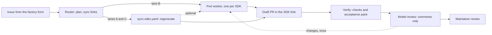

# SDK factory

The SDK factory carries one change across the OpenFGA SDKs. You describe the
change in an issue. The factory posts a plan, opens a draft pull request in
each SDK, checks each one, and gives each a first-pass model review. A
maintainer reviews and merges every pull request. The factory never merges,
approves, or pushes to a default branch.

This copy is a lab. It changes forks that belong to the owner of this
repository (the hub), never the upstream repositories.



## Lanes

| Lane | Source | What runs | Model calls |
|---|---|---|---|
| A: API spec bump | A commit, pull request or `tree/<ref>` of the API repository | `sync-sdks.yaml` regenerates each SDK against that spec and opens a sync PR | One review run per sync PR head. Port workers only if you ask for them |
| B: port an SDK change | A pull request, commit or issue in one SDK | One port worker per target SDK. Each opens a draft PR in its fork | One worker run per SDK. Each PR then gets up to two review runs and one revision run |
| C: generator template change | A pull request, commit or `tree/<branch>` of the generator, here or upstream | `sync-sdks.yaml` regenerates each SDK from that generator ref and opens a sync PR | Same as lane A |

The port worker and the reviewer are the only steps that call a model. The
router, the scanners, the sync job, the verify job and the trace job are plain
scripts.

Lanes A and C apply only what the change alters. The sync job builds each SDK
twice, both times on top of the SDK's main: once before the change and once
after. Git then merges the difference into main. Release versions, hand edits
and every line the change leaves alone stay as main has them. "Before" is
`OPEN_API_REF` in the Makefile for lane A, and for lane C the generator commit
before the change: the parent of a commit on main, or the point where a branch
left main. If the change touches a line that main edited by hand, the job
stops and names the files to merge by hand. `factory/scripts/delta_sync.sh`
does this. Some build steps run in Docker as root and leave files the runner
cannot write, so before the second build the script writes those files again
from main. A sync run without a change id still regenerates the whole SDK.

The sync job runs the generator, its Makefile and each SDK's tests. They can
come from an unmerged pull request, so that job gets no token or secret. It
saves each SDK's change as a patch. A second job, publish, holds the push
token and runs none of that code. It checks that the patch starts from a
commit on the SDK's main and leaves `.github/workflows` and `.github/actions`
as main has them. Then it commits the patch with Git hooks off, pushes the
sync branch and opens or updates the draft PR.

## Workflows

| Workflow | File | Trigger | What it does |
|---|---|---|---|
| SDK factory router | `factory-propagate.yml` | The `factory:propagate` label, or a manual run with an issue number | Checks that the sender and the issue author can write here, posts the plan, syncs the target forks and starts the lane |
| SDK factory port worker | `factory-port.md`, compiled to `factory-port.lock.yml` | Started by the router, the sync job or the reviewer | Ports one change into one fork and opens one draft PR. It stops early when the fork already has an open port PR for the change. In a revision run it adds one commit to the PR that a review asked to change |
| SDK factory reviewer | `factory-review.md`, compiled to `factory-review.lock.yml` | Started by the verify workflow | Reviews one factory PR head with a model from the other family than the PR's author. Posts one review that only comments, labels the PR, and on `changes` starts one revision |
| Sync SDKs with generator | `sync-sdks.yaml` | A manual run, or a push to main | Regenerates the SDKs in a job without secrets. A publish job then checks each patch and opens the sync PR. The factory adds a change id, delta mode, a record of the sync PRs and an optional port step |
| SDK factory verify | `factory-verify.yml` | After a worker or sync run, every 6 hours, or a manual run | Runs the checks and the acceptance pack on each open factory PR, labels it, reports, and starts the reviewer on each head that has no review |
| SDK factory trace | `factory-trace.yml` | After each port worker run, or a manual run with a run id | Reads the run's session log with agent-strace and comments the agent's evidence on each PR the run opened |
| SDK factory watcher | `factory-watch.yml` | Daily, or a manual run (a dry run by default) | Opens a `factory:candidate` issue for each feat or fix PR merged upstream that no factory issue covers |
| SDK factory API drift | `factory-api-drift.yml` | Weekly, or a manual run | Keeps one `factory:api-drift` issue open while the API is ahead of `OPEN_API_REF` in the Makefile |
| SDK factory fork sync | `factory-sync-forks.yml` | Daily, or a manual run | Brings the hub, the API fork and each SDK fork up to upstream main. Without `FACTORY_TOKEN` it only reports |
| SDK factory CI | `factory-ci.yml` | Pull requests and pushes that touch the factory | Unit tests, shellcheck, actionlint, and a check that the lock files are current |

`factory/sdks.yaml` is the registry, and the scripts read it on every run.
GitHub needs some lists written out, so a new SDK also needs an option in the
issue form's Target SDKs list, in the `sdk` input of the worker and of the
reviewer (then run `gh aw compile`), in `SYNC_SDKS` in `factory_route.py` and in the matrix of
`sync-sdks.yaml`. `test_factory.py` fails until these lists match the
registry. A new language also needs toolchain setup steps in the worker and in
`factory-verify.yml`. Then run `bootstrap.sh` again to label the new fork and
make its default token read-only.

## Start a change

1. Open an issue with the **SDK factory change** form. Only people with write
   access to the hub can start the router. It acts only on issues that such
   a person wrote, or that the factory's scanners opened.
2. Pick the lane and the kind of change. Leave **Model** on Auto unless the
   change needs a stronger or a cheaper model.
3. Write the source as a path, for example `openfga/js-sdk/pull/228`. A full
   URL also works, but it adds a "mentioned" event to the upstream thread.
4. Leave **Target SDKs** empty to reach every SDK in reach for that kind,
   minus the source SDK. SDKs you pick always run.
5. Tick **Plan only** the first time. The router posts the plan as a comment,
   lists any missing secrets, and starts nothing.
6. To run it, edit the issue, untick **Plan only**, then remove and re-add the
   `factory:propagate` label.

When the router starts work, it first posts a comment that says "Starting."
It then edits that comment into the plan, with a link to each workflow it
started. If the comment still says "Starting." after 15 minutes, the router
stopped part way. Read the router run that the comment links, then start the
issue again with force.

The router also runs in plan mode while `FACTORY_TOKEN` is missing, and for
lane B while `COPILOT_GITHUB_TOKEN` is missing. The plan says which secret to
add. To start an issue again after the factory already started it, run the
router by hand with **force** set:

```sh
gh workflow run factory-propagate.yml --repo <owner>/<hub> -f issue_number=42 -f force=true
```

You can also start one worker without the router, for example to retry one
SDK:

```sh
gh workflow run factory-port.lock.yml --repo <owner>/<hub> \
  -f sdk=go -f target_repo=<owner>/openfga-go-sdk \
  -f source=openfga/js-sdk/pull/228 -f change_id=custom-claims
```

### Retries and duplicates

A change gets at most one open port PR in each fork. Before the router or the
sync job starts a port worker, it looks in the fork for an open PR from a
`sdk-factory/<change id>` branch. gh-aw may add a suffix to that name. If it
finds one, it skips that SDK and links the PR. A worker checks again before
its agent starts, because a second worker for the same change and SDK waits
for the first to finish. Force does not skip this check. To port a change
again, close its port PR first.

A sync rerun pushes to the same `sync/factory-<change id>` branch and updates
its PR. When it generates the same files, it leaves both alone.

If the router starts nothing, for example because every dispatch failed, the
comment says "Nothing started." Fix the problem, then remove and re-add the
`factory:propagate` label. No force is needed. Once the router has started
any workflow for an issue, it starts that issue again only with force.

### Kind of change and reach

The **Kind of change** field decides which SDKs a change reaches when Target
SDKs is empty. `reach` in `factory/sdks.yaml` maps each kind to a list of SDKs,
or `all`. Lane B ports only to SDKs in reach. Lanes A and C still regenerate
every SDK and use reach only to decide where port workers run.

The `FACTORY_REACH` repository variable overrides `reach` per kind without a
commit. It takes JSON in the same shape:

```sh
gh variable set FACTORY_REACH --repo <owner>/<hub> --body '{"fix": ["go", "python"]}'
```

Kinds that the variable leaves out keep the value from `sdks.yaml`, and so does
a kind whose value is not `all` or a list. A variable that is not a JSON object
is ignored. The plan comment shows each warning and names any SDK that the
reach leaves out.

### Model

The router picks the port worker's model for each change. It takes the tier
from the **Model** field. On Auto it
takes the tier of the kind of change, then `default_tier`. `models` in
`factory/sdks.yaml` maps each tier to a model:

| Tier | Model | On Auto, used for | Fits |
|---|---|---|---|
| Deep | `claude-opus-5.5` | Baseline behavior | Auth, retries, streaming: ports that need care in every language |
| Standard | `gpt-6.1-sol` | Core API, other API, fix, and changes with no kind | Most ports |
| Light | `gpt-6-luna` | Nothing by default | Docs, examples and small fixes |

The plan comment names the model and says why the router picked it. Lane B
passes it to every worker. Lanes A and C pass it only to the port workers on
their sync PRs.

The `FACTORY_MODELS` repository variable overrides `tiers`, `kinds` and
`default_tier` without a commit. It takes JSON in the same shape:

```sh
gh variable set FACTORY_MODELS --repo <owner>/<hub> --body '{"tiers": {"deep": "gpt-5.6-sol"}}'
```

The variable cannot add a model. A model outside `models.allowed` keeps the
value from `sdks.yaml`, and the plan comment shows a warning. `models.allowed`
must match the `model` input of the worker and of the reviewer, and the tests
check that. The reviewer's model comes from `review`, as [Review](#review)
describes.

Haiku never runs. The `models` block of the worker and of the reviewer rejects
`*haiku*`, and it points
the gh-aw aliases that would try Haiku first (`mini`, `small-agent`,
`summarization` and `detection`) at `gpt-6-luna`. The router drops a Haiku
model from `sdks.yaml` or `FACTORY_MODELS`.

When a worker's model call fails with a server error or a timeout, or the
model is not available to the token owner, gh-aw retries the same call on
`gpt-6-sol`, then `gpt-5.6-sol`. Rate limits, auth errors and policy errors do
not switch models. The reviewer has no fallback. Threat detection always runs
on `gpt-6-luna`.

gh-aw counts AI credits from its own price list. It prices the fallback models
from the lock file and the model picked at run time on a best-effort basis, so
check real spend on the Copilot usage page.

## Acceptance packs

An acceptance pack judges a port with black-box tests that a worker cannot
edit. It lives in `factory/acceptance/<change-id>/`:

- `pack.yaml`: the source, `base_failure_pattern`, the `preserve` cases and
  `fixed_paths`, the directory each runner copies its tests into.
- `contract.md`: the option name and behavior each SDK must implement.
- `<sdk>/run.sh <sdk-checkout>`: copies the tests into the fixed path and runs
  them with the SDK's own test runner.

A pack must fail on the PR base with `base_failure_pattern`. Otherwise it
cannot show that the PR made the change. Name every fixed path with
`factory_acceptance`, `factoryacceptance` or `FactoryAcceptance`. The worker's
safe outputs drop files with those names, and the verify job fails a PR that
touches `fixed_paths`. `custom-claims` is the first pack. Its README records
the evidence.

## Verify

The verify job picks open PRs in the SDK forks whose head branch lives in the
fork, starts with `sdk-factory/` or `sync/factory-`, and has the `factory`
label. It verifies up to 10 heads per run and skips heads it already verified.
For each one it runs the SDK's install and `check` commands on the head, and
on the base when the head fails. When the change has a pack, it runs the pack
on both. It then sets one label:

| Label | Meaning |
|---|---|
| `factory:verified` | The checks pass, and the pack fails on the base and passes on the head |
| `factory:checks-passed` | The checks pass. The change has no pack |
| `factory:needs-human` | Verify could not decide, for example the checks also fail on the base |
| `factory:verify-failed` | A check or the pack fails because of this PR, or the PR edits the pack's fixed paths |

Its last job starts the reviewer.

## Review

Each factory PR head gets a first-pass review before a maintainer reads it.
After every verify run, the verify workflow's review job starts the reviewer,
`factory-review.md`, on each open factory PR whose head has a verify result
and no factory review. That includes heads that failed verify: the reviewer
reads the result and can say why.

The reviewer comes from the other model family than the PR's author, so no
model grades its own work. The port worker records the model it asked for in
the PR body as an `SDK-Factory-Model:` trailer:

| Author | Reviewer |
|---|---|
| A Claude model | `gpt-6.1-sol` |
| A GPT model | `claude-opus-5.5` |
| A sync PR, or a PR without the trailer | `claude-opus-5.5`, the default |

`review` in `factory/sdks.yaml` sets the reviewers, the rounds and the number
of inline comments. A reviewer must be in `models.allowed`, and Haiku never
reviews. The review job starts no reviewer for a head when:

- the head already has a factory review, or a review of it is running
- the last review said `human`, or the PR used all its rounds
- two finished runs for the head posted no review
- the job already started 5 reviews. The next verify run starts the rest
- `FACTORY_TOKEN` or `COPILOT_GITHUB_TOKEN` is not set

Its job summary gives the reason for each PR. To try a stopped head again,
start the verify workflow with its `pr` input:

```sh
gh workflow run factory-verify.yml --repo <owner>/<hub> -f pr=<owner>/<fork>/pull/<number>
```

The reviewer reads the PR, its diff, the source change, the verify result and
the factory's earlier reviews of the PR. The fork is checked out at the head.
Its tools only read: `git` log, diff, show, blame, grep and ls-files, `cat`,
`jq` and GitHub's repository and pull request tools. It runs no SDK code and
holds no write token. It calls `post_review` once, with a verdict, a summary
and findings. Each finding has a severity (blocker, major, minor or nit), a
file and line, and a fix. The post step then:

1. Checks again that the PR is open, the head has not moved and the round is
   the next one. Otherwise it posts nothing.
2. Makes the verdict match the findings. `ok` with a blocker or major finding
   becomes `changes`. `changes` with no findings, and findings that are not
   valid JSON, become `human`.
3. Posts one review on the head the reviewer read. The review only comments.
   Up to 8 findings that sit on a line of the diff become inline comments,
   most severe first. The rest stay in the review body. When GitHub rejects an
   inline comment, the step posts the review without them.
4. Sets one label and comments on the hub tracking issue:

| Verdict | Label | Next |
|---|---|---|
| `ok` | `factory:review-ok` | A maintainer reviews, approves and merges |
| `changes` | `factory:review-changes` | The port worker revises the PR once. The next round reviews the new head |
| `human` | `factory:review-human` | A maintainer takes over. The factory stops reviewing the PR |

### Revisions

On `changes`, when a round is left, the post step starts the port worker again
with the PR number in `revise_pr`. It uses the author's model, or the default
tier when the author is unknown. Only port PRs get a revision. They need the
`SDK-Factory-Origin` trailer and a change id. Sync PRs come from the
generator, so fix the generator change instead.

The worker checks out the PR branch at the reviewed head and reads the review
as data, not orders. It fixes the findings it agrees with, runs the checks
and the pack, and pushes one commit, `chore: address factory review round
<n>`, to the same PR. The commit lists each finding as fixed or declined,
with a reason. The worker reports `revised`, `revise-declined` when it
declines every finding, or `blocked` when it cannot make the checks pass.

The push only adds commits, and it needs the `factory` label on the PR. It
drops the same files as a new port. It refuses a change to a dependency
manifest, an agent instruction file or another dot folder, because a push
gets no review gate. A maintainer makes those changes.

Verify then checks the new head, and the next round reviews it. With the
default of 2 rounds, a PR gets at most two reviews and one revision. Then a
maintainer takes over.

### Limits

- Reviews post with `FACTORY_TOKEN`, so they show as the fork owner's
  comments. GitHub does not let a PR's author approve their own PR or request
  changes on it, which is one more reason they only comment. A GitHub App
  would post as a bot.
- The reviewer has no fallback model. When its model fails, the run posts
  nothing, and the next verify run tries once more.
- The trailer names the model the worker asked for. When gh-aw fell back to
  another model, the reviewer can come from the family that wrote the code.
- A revision run's agent evidence stays in its trace job summary and
  artifact. The PR body names the run that opened the PR, so the trace job
  does not comment.
- Set `FACTORY_COPILOT_REVIEW` to `on` to also request GitHub's Copilot code
  review on round 1. The job summary says when the fork's owner cannot use
  it.

## Agent evidence

The verify job checks what a PR changed. The trace job shows how the agent got
there. After each port worker run, `factory-trace.yml` downloads the run's
`usage` artifact, where gh-aw keeps the session log and its usage numbers.
[agent-strace](https://github.com/Siddhant-K-code/agent-trace) imports the log
and runs `review`, `health` and `lint` on it. The report job then posts one
comment on each factory PR the run opened, or updates it when the run is read
again. The comment shows:

- the model, the run's AI credits and tokens, and the agent's tool calls
- agent-strace's review of rationale, scope, validation, stewardship and
  evidence health, each with a status and a confidence
- session health and lint counts
- the commands to replay the session

The comment is advisory. It shows the agent's own session, not CI, and sets no
label. Cost comes from gh-aw, which counts the AI credits the run spent.
agent-strace estimates cost from token list prices, so the comment does not
use it. The comment holds only counts, statuses and agent-strace's short
review notes, set as code. Prompts and tool output stay in the run's `usage`
artifact. agent-strace's full reports and its HTML evidence packet stay in the
`factory-trace-<run id>` artifact for 14 days.

`factory/scripts/agent-strace.txt` pins agent-strace by version and hash.
Change both together. To read a run again, start the workflow by hand. A run
in another repository, such as a public gh-aw run, gets only the job summary:

```sh
gh workflow run factory-trace.yml --repo <owner>/<hub> -f run_id=<run id>
gh workflow run factory-trace.yml --repo <owner>/<hub> -f run_id=<run id> -f repo=<owner>/<name>
```

## Setup

You need `gh`, signed in as the owner of the hub and the forks, and
[`yq`](https://github.com/mikefarah/yq).

1. Fork the API repository, the generator and each SDK in `factory/sdks.yaml`
   to one owner. The `repo` fields name the forks.
2. Merge the factory into the hub's default branch, so GitHub registers its
   workflows.
3. Run `factory/scripts/bootstrap.sh <owner>/<hub>`. It turns on issues and
   Actions in the hub, sets `FACTORY_SKIP_PUSH_SYNC=true`, makes the default
   workflow token read-only in the hub and in each SDK fork, creates the
   labels in the hub and in each fork, and enables the factory workflows. It
   is safe to run again.
4. Add the two secrets that `bootstrap.sh` lists. Both are fine-grained
   personal access tokens. `bootstrap.sh` prints links that fill in the name,
   the description and the permissions.
   - `FACTORY_TOKEN` does the factory's GitHub writes: it syncs the forks,
     pushes sync branches and revisions, opens draft PRs and posts reviews in
     the forks, and comments on hub issues and PRs. Pick the owner of the
     forks as the resource owner, then **Only
     select repositories**: the hub, the API fork and every SDK fork. Give it
     Read and write on Contents, Issues, Pull requests and Workflows. Fork
     sync needs Workflows, because GitHub refuses to sync a fork when
     upstream changed `.github/workflows`. No agent sees this token.
   - `COPILOT_GITHUB_TOKEN` pays for model calls. Pick your user account as
     the resource owner and give it the account permission Copilot Requests.
     It needs no repository access. Only the agent and threat detection jobs
     of the worker and the reviewer read it. The account needs an active
     Copilot seat, and
     the calls count against that seat. Copilot policy must allow the models
     in `models.allowed` and the Copilot CLI. gh-aw rejects OAuth tokens
     (`gho_`).

   ```sh
   gh aw secrets set FACTORY_TOKEN --repo <owner>/<hub>
   gh aw secrets set COPILOT_GITHUB_TOKEN --repo <owner>/<hub>
   ```

   `gh secret set` and the repository's **Settings > Secrets and variables >
   Actions** page also work. gh-aw's keyless option,
   `permissions: copilot-requests: write`, needs a repository that an
   organization owns and pays for, so this lab uses the token.
5. Check the secrets. `gh aw secrets bootstrap --non-interactive --repo
   <owner>/<hub>` checks `COPILOT_GITHUB_TOKEN`. `gh aw doctor`, run in a
   checkout of the hub, checks `FACTORY_TOKEN`; with `--repo` it only checks
   that the repository exists. Neither can see a token's permissions or
   expiry.
6. Run the fork sync, then open a plan-only issue. The plan lists any missing
   secret.

### Repository variables

| Variable | Effect |
|---|---|
| `FACTORY_PAUSED` | `true` stops every factory workflow, including the port worker and the reviewer |
| `FACTORY_SKIP_PUSH_SYNC` | `true` stops a push to main from opening sync PRs. `bootstrap.sh` sets it |
| `FACTORY_REACH` | Overrides `reach` per kind of change |
| `FACTORY_MODELS` | Overrides the port worker's model per tier and the tier per kind of change |
| `FACTORY_REVIEW` | `off` stops new and queued reviews |
| `FACTORY_COPILOT_REVIEW` | `on` also requests GitHub's Copilot code review on review round 1 |
| `FACTORY_AGENT_TRACE` | `false` stops the trace workflow and its evidence comments |
| `SDK_REPO_OVERRIDES` | Points `sync-sdks.yaml` at other SDK repositories |
| `GH_AW_DEFAULT_MAX_DAILY_AI_CREDITS` | The daily AI credit cap of the worker, and a separate one of the reviewer. The default is 2400, and `-1` turns the cap off |
| `GH_AW_DEFAULT_DETECTION_MAX_AI_CREDITS` | The threat detection cap per run. gh-aw's default is 400 |

## Safety model

- **Draft PRs and human merges.** Workers open draft PRs, and the factory
  never merges, approves or pushes to a default branch. Its reviews only
  comment.
- **The agent holds no write token.** The worker runs in the gh-aw sandbox
  behind a network allowlist. It asks for writes through safe outputs: one
  draft PR in its target fork, or in a revision run one commit on the factory
  PR it revises, and one comment on the hub issue. A threat
  detection job reviews the output before the safe outputs job applies it.
  When detection flags the output or fails to finish, the run opens no PR and
  posts no comment. Release files, pack test copies and everything under
  `.github/` are dropped from the patch, because a fork runs a pushed
  branch's workflows before anyone reviews it. A patch that touches a
  dependency manifest, an agent instruction file or another dot folder still
  opens, with a review that requests changes. A revision push that touches
  one of those files fails instead, because a push gets no review gate.
- **The reviewer reads and comments.** It reads the PR head as data and runs
  none of its code. Its tools only read, and it holds no write token. It asks
  for one review through a safe output, and threat detection checks that
  output first. The post step holds `FACTORY_TOKEN`, reads the verdict and
  findings field by field, and posts one review that only comments. It puts
  @mentions and links to other owners' repositories in code. The reviewer has
  only a manual trigger, which GitHub allows only to users with write access,
  so it turns off gh-aw's role check. That check would refuse the verify
  job's token.
- **Verify is advisory.** The verify job runs PR code in the same job as the
  checks, so a PR can change what that job reports. The job gets no secrets.
  The report job holds `FACTORY_TOKEN` and reads the verify results as data,
  field by field. A maintainer still reviews every PR.
- **The trace reads untrusted data.** The agent can write parts of the session
  log. The trace job holds a read-only token, and agent-strace runs with no
  token, in an empty directory. The report job holds `FACTORY_TOKEN`, reads the
  trace field by field, and comments only on an open factory PR in a fork
  whose body carries the run's gh-aw marker. gh-aw strips that marker from the
  agent's own text.
- **Who can start a change.** The gate checks that the label sender can write
  to the hub. The router acts on the issue body, so it also checks that the
  issue author can write. Issues the factory's scanners open pass, because a
  maintainer still adds the label.
- **No dependency caches.** The sync, worker and verify jobs restore no
  dependency cache, and their setup actions run with caching off. Code that
  ran in one job cannot change what another job builds or pushes.
- **Generated code runs without secrets.** Lanes A and C run the source's
  spec, generator templates and Makefile, which can come from an unmerged
  pull request. The sync job that runs them holds no token or secret. The
  publish job holds the push token and runs none of that code. It refuses a
  patch that does not start from a commit on the SDK's main, or that edits
  `.github/workflows` or `.github/actions`. A pushed branch therefore runs
  only the workflows its fork's main already has. Those workflows still run
  the generated code in the fork's CI. The forks hold no secrets, and
  `bootstrap.sh` makes their default workflow token read-only. A fork job that
  asks for write scopes still gets them, so read a fork's workflows before you
  add it. In the five forks today, only CodeQL asks for one on pull requests:
  it can upload code scanning results. Only start a lane on changes you have
  read.
- **One port PR per change and SDK.** The router, the sync job and the worker
  each skip an SDK whose fork already has an open port PR for the change.
- **Cost caps.** Each worker run may spend 600 AI credits, enough for a deep
  tier run, and all worker runs together 2400 in a rolling 24 hours. Each
  review run may spend 300, and all review runs together another 2400. Keep
  `max-ai-credits` a plain number: gh-aw v1.2.2 replaces an expression there
  with its default of 1000. gh-aw counts the daily total from an Actions
  cache, so treat the cap as a cost control, not a security boundary.
- **Loop guards.** The worker refuses a source that is itself a factory PR. The
  watcher skips factory PRs. A PR gets at most `review.rounds` reviews, with
  one revision between two rounds, and a `human` verdict ends them. Factory
  comments, reviews and PR bodies cite upstream work
  as paths without a host, so upstream threads get no "mentioned" events.
- **Base branch checkout.** `gh aw compile --strict` warns that the worker
  checks out `base_branch` before host setup steps run. The router only passes
  `main` or a branch in the target fork, and the setup steps read version
  files but run no repository code. Keep it that way.

## gh-aw in a fork

gh-aw documents that agentic workflows do not run in forks. gh-aw v1.2.2 adds
that guard only to its maintenance jobs, `workflow_run` safety checks and work
queues, and the compiled worker has none, so the worker runs in this fork. A
later gh-aw release may guard every job. If the worker then skips in a fork,
move the hub to a repository that is not a fork.

## Operations

- Set `FACTORY_PAUSED` to `true` to stop the factory. A paused worker skips
  every job and spends nothing.
- After lane A's sync PRs merge, set `OPEN_API_REF` in the Makefile to the
  same API commit. The next drift scan then closes the drift issue, and the
  next delta sync measures from that commit.
- When a delta sync stops on hand-edited lines, run
  `factory/scripts/delta_sync.sh <language>` from the generator root with the
  SDK in `clients/fga-<language>-sdk`, Docker running, and the job's
  `NEW_OPENAPI_REF` or `BASE_GENERATOR_DIR`. It stops with conflict markers in
  the files it names. Resolve them, commit, and push to the sync branch.
- `config/common/openapi-compat.jq` runs on every downloaded API document. It
  keeps the request model names the SDKs export, and it skips operations
  tagged `AuthZenService` until maintainers choose to generate them. Users
  reach those operations through each SDK's API executor. Edit
  `skipped_tags` to change that.
- After you change `factory-port.md` or `factory-review.md`, run
  `gh aw compile --strict` with gh-aw v1.2.2 and commit the lock files. CI
  fails when a lock file is stale.
- Run the factory's tests with
  `python3 -m unittest discover -s factory/scripts -v`.
